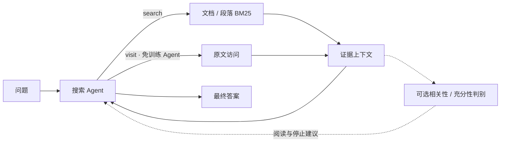
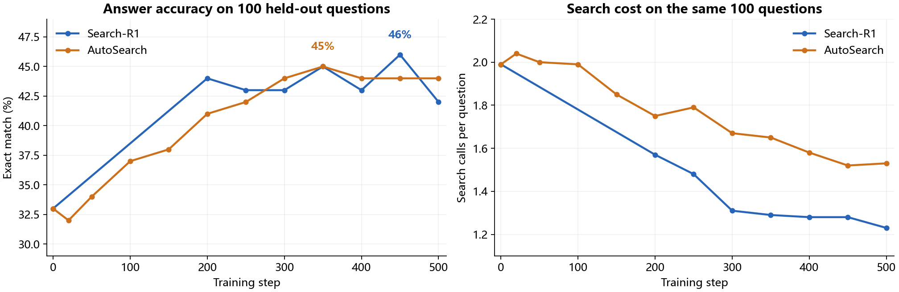

# Search Agent

围绕搜索 Agent 的证据利用、重复搜索与停止决策，整合段落级检索、可替换证据判别，以及 4B 模型的 Search-R1 / AutoSearch 强化学习训练。

- **检索改造**：BrowseComp-Plus 50 题上，准确率 **38% → 70%**，平均查询数 **22.52 → 16.04**。
- **策略训练**：固定 100 题上，4B 基模 EM 为 **33%**，Search-R1 最佳评测点达到 **46%**。
- **效率探索**：AutoSearch 最佳 EM 为 **45%**；20 → 500 步，平均搜索次数 **2.04 → 1.53，下降 25%**。

## 核心实现



| 模块 | 关键实现 |
|---|---|
| 免训练 Agent | ReAct 搜索与阅读；段落按 256 词切分、重叠 64 词，保留原文位置 |
| 证据判别 | 支持本地 9B、DeepSeek、JEV；相关性提供阅读建议，充分性控制回答时机 |
| Search-R1 | veRL + GRPO + LoRA；模型生成搜索 query，依据最终答案获得奖励 |
| AutoSearch | 训练中逐轮生成独立回答探测，加入质量增益与搜索效率奖励 |
| 训练与评测 | 检索内容 loss mask、完整状态续跑、按评测点输出答案及搜索轨迹 |

## 结果

### 免训练搜索 Agent

**评测数据：BrowseComp-Plus 自选 50 题；27B 主模型；正确性采用模型辅助判分。**

| 配置 | 答对 / 准确率 ↑ | 平均查询数 ↓ | 平均访问文档数 |
|---|---:|---:|---:|
| 文档级检索 | 19/50 · 38% | 22.52 | 1.02 |
| 段落级检索 | 35/50 · 70% | 16.04 | 1.44 |
| 段落检索 + 本地 9B 判别 | 34/50 · 68% | 14.10 | 1.28 |
| 段落检索 + DeepSeek 判别 | 31/50 · 62% | 15.98 | 1.18 |
| 段落检索 + JEV 判别 | 32/50 · 64% | 15.34 | 0.88 |

段落检索相对文档检索提高 **32 个百分点**，平均查询数下降 **28.8%**。外部判别可以改变阅读与停止行为，但在这组题上未超过直接使用段落检索。

### 4B 模型训练

**当前训练配置：Qwen3.5-4B，NQ / HotpotQA 各 2500 题；固定评测集：NQ、HotpotQA、Bamboogle、TriviaQA 各 25 题。**

| 配置 | 默认值 |
|---|---|
| 优化 | GRPO，学习率 `1e-5`；每步 8 题 × 4 条 rollout |
| LoRA | rank 8、alpha 16，`q_proj` / `v_proj` |
| 上下文与检索 | 16K；top 3 段落，工具结果合计最多 1536 token |
| 多轮预算 | 最多 4 次搜索、6 个助手回合 |

EM 按最终短答案归一化精确匹配；平均搜索次数统计每题 `search` 工具调用。参考 [AutoSearch 的评测指标](https://arxiv.org/html/2604.17337#S5.SS1)，**SE = EM（%）÷ 平均搜索次数**，数值越大表示单位搜索开销对应的答题效果越好。以下为固定 100 题上的结果，与上面的 27B / BrowseComp-Plus 分组展示。



**Search-R1**：最佳评测点为 450 步，EM **46%**、平均搜索 **1.28 次**；相对基模提升 **13 个百分点**。500 步为 42%，展示最佳点与最终点的差异。

<details>
<summary>展开 Search-R1 各评测点</summary>

| Step | EM ↑ | 平均搜索次数 ↓ | SE ↑ |
|---|---:|---:|---:|
| Base | 33% | 1.99 | 16.58 |
| 200 | 44% | 1.57 | 28.03 |
| 250 | 43% | 1.48 | 29.05 |
| 300 | 43% | 1.31 | 32.82 |
| 350 | 45% | 1.29 | 34.88 |
| 400 | 43% | 1.28 | 33.59 |
| 450 | 46% | 1.28 | 35.94 |
| 500 | 42% | 1.23 | 34.15 |

仅列已有的固定 100 题评测结果。独立重训参考：20 步 EM 为 34%，平均搜索 1.98 次，未并入主曲线。

</details>

**AutoSearch**：最佳评测点为 350 步，EM **45%**；500 步为 **44%**、平均搜索 **1.53 次**。20 → 500 步搜索次数下降 25%，格式合规率由 **65% 提升至 91%**。

<details>
<summary>展开 AutoSearch 各评测点</summary>

| Step | EM ↑ | 平均搜索次数 ↓ | SE ↑ | 格式合规率 ↑ |
|---|---:|---:|---:|---:|
| 20 | 32% | 2.04 | 15.69 | 65% |
| 50 | 34% | 2.00 | 17.00 | 71% |
| 100 | 37% | 1.99 | 18.59 | 78% |
| 150 | 38% | 1.85 | 20.54 | 82% |
| 200 | 41% | 1.75 | 23.43 | 85% |
| 250 | 42% | 1.79 | 23.46 | 85% |
| 300 | 44% | 1.67 | 26.35 | 89% |
| 350 | 45% | 1.65 | 27.27 | 91% |
| 400 | 44% | 1.58 | 27.85 | 90% |
| 450 | 44% | 1.52 | 28.95 | 91% |
| 500 | 44% | 1.53 | 28.76 | 91% |

</details>

两套训练均改善了基模表现；本次结果中，Search-R1 最佳点的准确率更高、搜索次数更少，AutoSearch 体现出自身随训练降低搜索开销的趋势。

**分数据集结果**（每类 25 题，表内为答对题数）：

| 模型 / Step | NQ | HotpotQA | Bamboogle | TriviaQA | 总 EM |
|---|---:|---:|---:|---:|---:|
| 基模 | 3/25 | 8/25 | 8/25 | 14/25 | 33% |
| Search-R1 · 450 | 8/25 | 10/25 | 12/25 | 16/25 | 46% |
| AutoSearch · 350 | 7/25 | 8/25 | 14/25 | 16/25 | 45% |
| AutoSearch · 500 | 7/25 | 8/25 | 13/25 | 16/25 | 44% |

### 奖励设计

| 方法 | 本项目使用的训练奖励 |
|---|---|
| Search-R1 | 答对 `1`，答错 `0`，最终答案格式不合规 `-0.1` |
| AutoSearch | 基础答案奖励 + 分轮回答的 F1 质量增益 + 搜索效率奖励，累加后用于 GRPO |

AutoSearch 的回答探测只读取当前可见问题与证据；参考答案仅用于奖励计算。评测阶段关闭探测，正常统计搜索次数。两种方法的总奖励定义不同，结果表使用统一的 EM、搜索次数和 SE；过程奖励的实现见 [`autosearch/process_reward.py`](autosearch/process_reward.py)。

### 轨迹案例：证据判别仍会遇到重复搜索

BrowseComp-Plus **q413**：根据奥运冠军、奖金与赠奖者的线索，追查赠奖者取得高中毕业证时的年龄。

| 配置 | 查询数 | 完全重复查询 | 最终结果 |
|---|---:|---:|---|
| 文档检索 | 38 | — | 输出超限，未完成 |
| 段落检索 | 10 | 0 | 正确：20 岁 |
| 段落检索 + JEV | 40 | 24 | 达到轮数上限，未作答 |

重复查询仅忽略大小写与连续空白。JEV 轨迹中，两条围绕奥运亚军及其父母国籍的 query 各重复了 13 次。这个案例体现了“检索命中或证据判别”与“有效推进搜索并及时停止”的区别，也是引入模型策略训练和过程奖励的动机。

## 代码结构

```text
agent/          ReAct 循环与判别器
search_r1/      GRPO 训练、工具、数据转换与最终答案奖励
autosearch/     分轮回答探测与过程奖励
retrieval.py    文档/段落索引与检索服务
evaluate.py     统一答案与搜索次数评测
```

## 使用

### 1. 检索与 Agent

Linux 环境需要 Java 17。模型使用 OpenAI 兼容接口；把 `.env.example` 复制为 `.env` 后填写自己的配置。

```bash
pip install -e ".[retrieval]"
python retrieval.py index --corpus data/corpus.jsonl --output data/passages
python retrieval.py serve --index data/passages
```

语料格式为每行 `{"id":"doc1","contents":"文档正文"}`；索引时加 `--mode document` 可切换为文档级检索。已有 Lucene 索引可直接传给 `serve --index`，外置语料库用 `--corpus-db` 指定。

另开终端运行 Agent：

```bash
python -m agent.core --question "Which country contains Paris?" --output runs/demo
python -m agent.core --questions data/eval100.jsonl --decision jev --output runs/jev
```

`--decision` 支持 `none / local / deepseek / jev`；本地与 DeepSeek 后端通过 `DECISION_*` 配置。

### 2. 模型训练

训练环境使用 Linux、Python 3.12、PyTorch 2.13 + CUDA 13、vLLM 0.29，实测单卡 RTX 6000D。先准备匹配的 PyTorch/vLLM 环境，再安装训练依赖和固定版本 veRL：

```bash
pip install -e ".[train]"
pip install git+https://github.com/volcengine/verl.git@dc709afb7a74fd2645640a4e5f2fdf40166b4fbb
```

将基模放到 `MODEL_PATH`，准备 `data/train5000.jsonl` 和 `data/eval100.jsonl`，每行格式：

```json
{"id":"nq:1","question":"问题","answers":["答案"],"data_source":"nq"}
```

```bash
python -m search_r1.data
python -m search_r1.train --mode eval --base --output runs/base
python -m search_r1.train --method search-r1 --output runs/search-r1
python -m search_r1.train --method autosearch --output runs/autosearch
```

默认训练至 500 步，在 20 步及每 50 步评测并保存结果。`--resume <checkpoint目录>` 恢复权重、优化器和采样进度；`--dry-run` 只生成配置。AutoSearch 探测仅在训练阶段启用。

### 3. 独立评测

```bash
python evaluate.py --questions data/eval100.jsonl \
  --trajectories runs/jev/trajectories --output runs/jev/summary.json
```

训练、评测和轨迹输出均保存在各自 `runs/` 下，数据、权重和真实密钥不纳入仓库。

## 参考

[Search Agent](https://github.com/liuqi6777/search_agent) · [Search-R1](https://github.com/PeterGriffinJin/Search-R1) · [AutoSearch](https://github.com/bofusun/AutoSearch) · [AutoSearch 论文](https://arxiv.org/abs/2604.17337) · [veRL](https://github.com/volcengine/verl)

相关方法的核心代码经整理适配，许可见 `LICENSE`。
